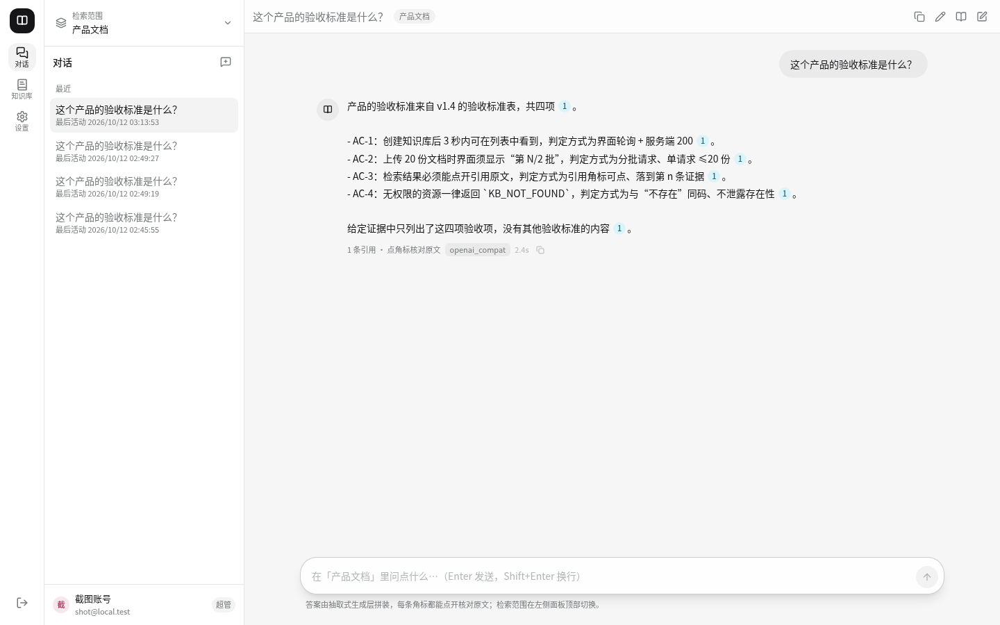
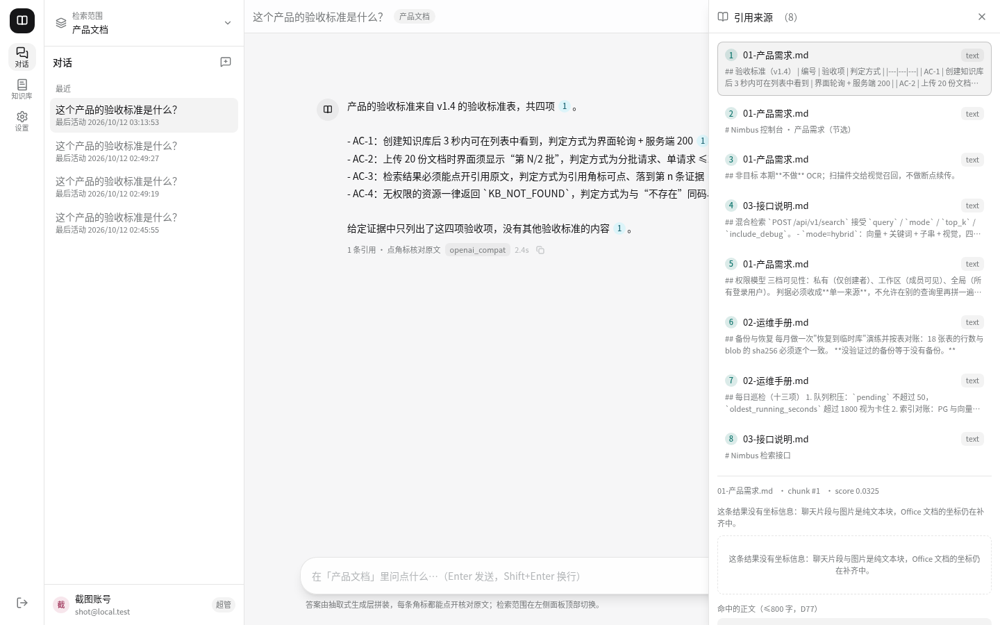
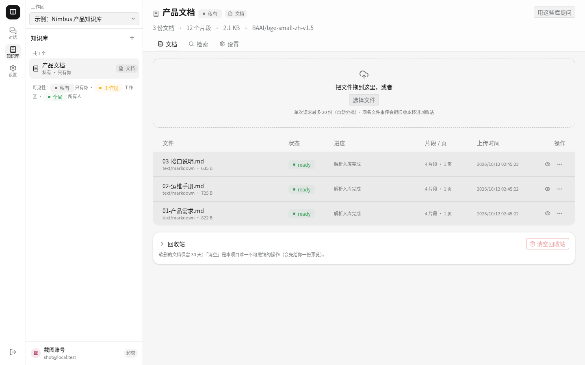
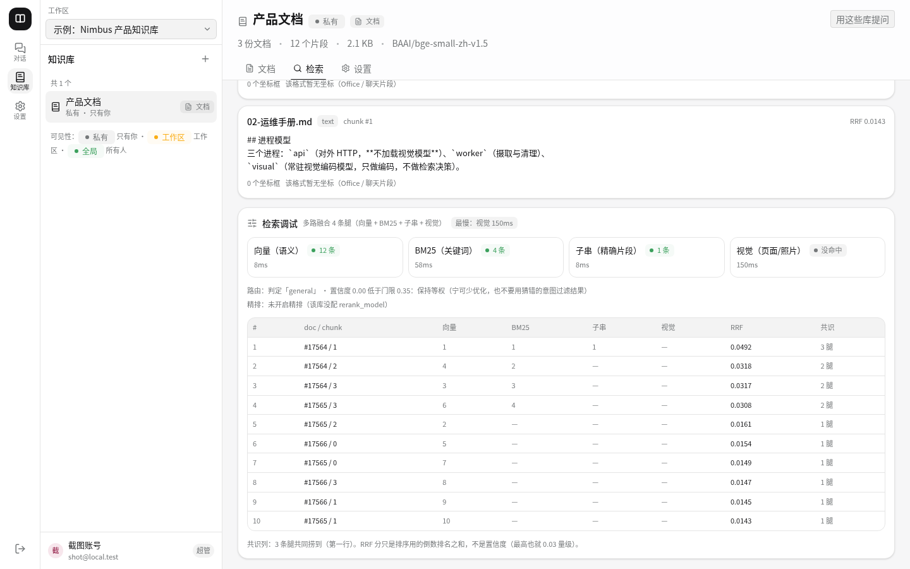
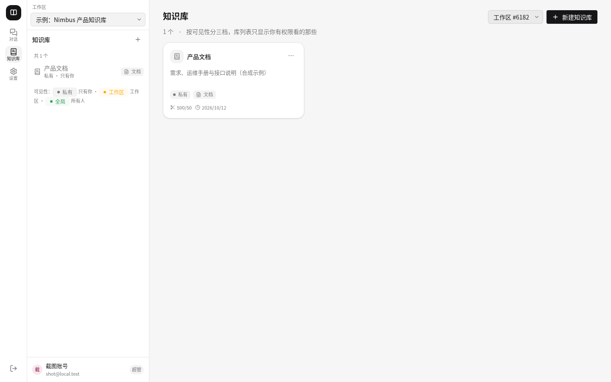
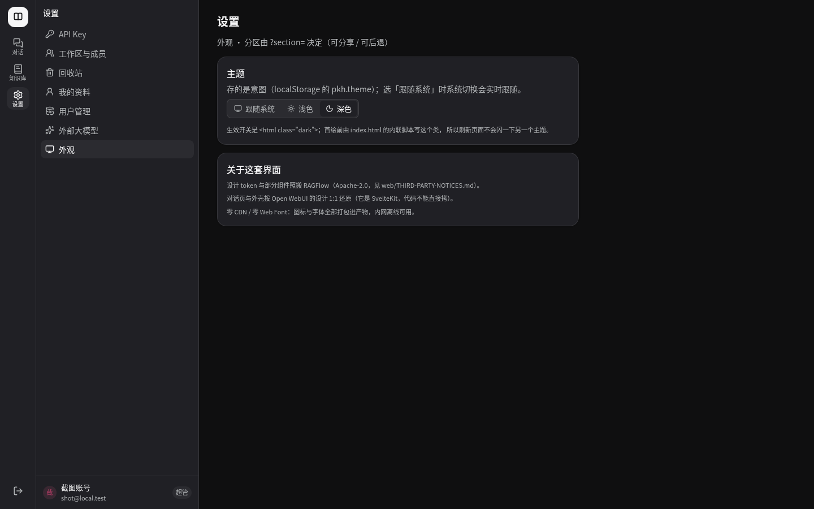

# Knowledge Hub · 多源知识库与 RAG 助理

[](https://github.com/HanphoneJan/knowledge-hub/actions/workflows/ci.yml)
[](https://www.python.org/)
[](https://fastapi.tiangolo.com/)
[](https://github.com/pgvector/pgvector)
[](https://qdrant.tech/)
[](https://react.dev/)
[](./LICENSE)

**多租户知识库服务**：上传文档 / 照片 → 解析 → 切分 → 嵌入 → **四路索引**（向量 + BM25 + 子串 + 视觉）
→ 带**引用溯源**的 RAG 问答与检索，并对外提供 **MCP**（给 AI 客户端）与 **A2A**（给别的 Agent）。
单机自部署、局域网可用；默认生成层是**抽取式**，答案句子全部摘自原文 ⇒ 引用 100% 可核验、**零外传**。

> 运行时数据在 `data/`（不进 git）。

| | |
|---|---|
| 契约 | **82** 个端点声明 / 81 实现 / 1 明确不做；`eval/contract_check.py` 守路径·方法·**参数面** |
| 测试 | pytest **1335** · 前端 vitest **316** · 三套验收 1b **138** / 1c **218** / 1d **199** |
| 检索 | 四条腿 RRF 融合：dense（bge-small-zh）· BM25（自实现）· trgm · **视觉**（colSmol late-interaction 多向量 MaxSim）|
| 前端 | React 19 + Vite 7 + Tailwind v4；**零 CDN / 零 Web Font**（内网离线可用）|
| 规模 | services ≈ **25k** 行（90 个模块）· 测试 ≈ **23k** 行（80 个文件）· 前端 ≈ **16k** 行 |

> 下图为**合成演示数据**（自造的产品 / 运维 / 接口文档），不含任何真实资料。

| 对话（角标可点开核对原文） | 引用抽屉（逐条命中片段 + 原文出处） |
|---|---|
|  |  |

| 知识库 · 文档（拖拽上传 + 状态 + 进度） | 检索调试（四路召回 + RRF 过程） |
|---|---|
|  |  |

| 知识库列表 | 设置 · 外观（深色） |
|---|---|
|  |  |

## 这是什么 / 解决什么问题

个人或小团队手上有一堆**散落的多源资料**（办公文档、聊天记录、照片），
想"问一句话就能定位到原文那一页那一句"。这类需求有三条不能让步：

1. **可核验** —— 每个结论都要能点回原文（所以引用做成了 L3 级别：页图 + 命中框）
2. **不外传** —— 默认不把私人原文发给任何外部服务（抽取式生成层；接外部 LLM 必须显式配置）
3. **可运维** —— 单机自部署，有任务队列、进度、索引对账、备份与**恢复演练**

## 架构（30 秒）

```
        前端 React 19 / Vite（对话 · 知识库 5 个 tab · 设置 7 分区）
                              │ REST + SSE（Bearer API Key）
┌──────────────┐   ┌──────────▼──────────────────────────────┐
│ worker       │   │ API（FastAPI）                           │
│ 摄取 / 清理   │◀─▶│ · 租户过滤**唯一来源** ctx.readable_kb_ids │
│ （任务队列）   │jobs│ · 检索只有一套实现 services/retrieval/    │
└──────┬───────┘   └───────┬──────────────────┬──────────────┘
       │ 视觉编码（可远端）   │                  │
┌──────▼────────┐   ┌───────▼────────┐  ┌──────▼─────────┐
│ visual_service│   │ PostgreSQL     │  │ Qdrant         │
│ colSmol 常驻  │   │ + pgvector     │  │ dense/sparse/  │
│ 只做编码      │   │ （真相来源）     │  │ visual 三集合   │
└───────────────┘   └────────────────┘  └────────────────┘
   MCP（4 工具）/ A2A（2 skill）复用同一套检索内核
```

## 亮点（都能在仓库里找到实现与守卫）

- **四路混合检索 + 可解释降级**：任一条腿不可用时**如实返回 `skipped` 与可操作原因**，检索仍返回 200 ——
  界面上不会把"没跑"画成"没命中"（调试面板把每一路的条数 / 耗时 / 跳过原因摊开）
- **租户隔离收口**：可见性判定只在 `services/common/auth.py`，Qdrant 过滤与 PG 谓词**同源**；
  无权限与不存在**同码**（`KB_NOT_FOUND`，不泄露存在性）
- **L3 引用坐标**：`bbox` 归一化 0~1 → 乘回页图像素 → 画在页图上；表格 chunk 按 `row`/`col` 排网格渲染
- **文档处理与切分**：6 种切分策略（定长 / 递归 / 语义 / 父子块 / Late / Contextual）+ 分层校验 + 多栏阅读顺序 +
  DOCX 标题 + 表格 Markdown 化；默认策略 = 现行为，改策略只对之后重新摄取生效（界面会提示"重摄取欠账"）
- **表格结构化**：表格除了 Markdown 文本，还落一份**结构化网格**（`table_json`，前端渲染成真表格）
  与一句**纯规则生成的描述**（"N 行 × M 列；表头：…"，进索引、不外传）—— 让"一览表"类查询能召回表格
- **任务终态与进度**：`jobs.progress` 是**唯一**百分比来源；没有任务行就不显示进度条；
  worker 在成功与失败**两条**路径上都结算文档状态
- **契约治理**：端点路径 / 方法 / 参数面三向对账 + 文档指向守卫（`tests/test_docs_pointers.py`）
- **工程化**：备份 → 恢复到临时库 → 逐表行数与 blob `sha256` 对账（真演练过）；
  十四项巡检（"跳过"不算健康）；`deploy/ci.sh` 让 CI 与本地共用同一条门禁

## 快速开始

```bash
bash deploy/dev.sh start      # 起 API(8010) + worker + 视觉查询服务(8020)
bash deploy/dev.sh stop
bash deploy/dev.sh restart    # 改了后端代码之后用这个（见下方 ⚠️）
PKH_WORKERS=4 bash deploy/dev.sh start   # 多 worker（需 VISUAL_WRITE_VIA_SERVICE=true）

# 视觉服务也可**单独**管理（2.65GB 的那一个；脚本化，不用 systemd）：
bash deploy/visual.sh {start|stop|restart|status|logs}

# ⚠️ `dev.sh` **只有** start / restart / stop 三个子命令（没有 status/logs）。看状态：
curl -s --noproxy '*' http://127.0.0.1:8010/health   # 队列/索引状态（公开版）
tail -20 /tmp/pkh_api.log /tmp/pkh_worker.log /tmp/pkh_visual.log   # 三个进程三个日志
```

⚠️ 视觉查询服务**首次启动要 13s**（加载 colSmol，约 2.65GB），`dev.sh` 等不到它也会正常退出 ——
那段时间里视觉腿降级成 `skipped`，检索照常。不想要它：`VISUAL_SERVICE_URL=`（留空）关掉读侧，写入侧不受影响。

- 界面：<http://127.0.0.1:8010>（由 FastAPI 托管 `web/dist`）
- 改过前端要 `cd web && npm run build`（dev.sh **不会**替你构建）
- 建账号：`uv run python -m services.api.scripts.create_user`（自助注册默认关）
- 巡检：`uv run python deploy/monitor.py`（十四项；**跳过不算健康**）
- 备份 / 恢复：`deploy/backup.sh` / `deploy/restore.sh`
- 首次要账号有数据：`uv run python deploy/seed_photos.py`（持久照片库）

⚠️ 改了后端代码要 `bash deploy/dev.sh restart`；**只 kill 进程组 leader 杀不干净子进程**，
旧 worker 会继续用旧代码处理任务（症状："改了没生效"）。

## 验收：本机全量 vs CI 门禁

| | 跑什么 | 为什么这么分 |
|---|---|---|
| **本机全量** | `uv run pytest`（1335）· 三套 eval（138 / 218 / 199）· `monitor.py` 十四项 | 需要真实 Postgres(pgvector) + Qdrant + **本地缓存的模型**（`bge-small` ~100MB；视觉腿 colSmol 2.65GB），而本项目有一条硬约束是**模型离线加载** |
| **CI 门禁** | `bash deploy/ci.sh`：前端 `typecheck + vitest + build` · 契约覆盖率 · **443 项免基础设施单测** | 不需要 DB / 模型 / 一个在跑的服务 / 特定 locale ⇒ 在托管 CI 上**必然**绿灯；把全量塞进 CI 只会得到"视觉腿静默 skipped"的假绿灯 |

🔑 CI 与本地跑的是**同一份**命令（workflow 只是调 `deploy/ci.sh`）：

```bash
uv run pytest                  # 1335 项
uv run python eval/contract_check.py
uv run python eval/api_1b_check.py   # 138 项
uv run python eval/api_1c_check.py   # 218 项
uv run python eval/api_1d_check.py   # 199 项
cd web && npm test             # 316 项
uv run python deploy/monitor.py       # 十四项巡检
bash deploy/ci.sh              # CI 那一道门禁（本地同款）
```

## 目录结构

```
services/
  api/          FastAPI：routers/（端点）+ main.py + static_site.py（前端托管）
  common/       models / auth（租户过滤唯一来源）/ deps / jobs / storage / consistency（对账）
  ingest/       parsers.py（解析器派发表）/ strategies（切分策略）/ validate（分层校验）/
                chunker / locations / versions / contextual / purge / privacy（归属判定）
  retrieval/    fusion（RRF 融合）/ dense / sparse / bm25 / visual / rerank
                ask / llm / routing / pool / trgm
  visual_service/ 常驻 colSmol 的**只做编码**的进程：POST /encode · /encode_image + /health
  worker/       handlers/（摄取与清理任务）+ doc_state.py（终态判定）
  mcp/          MCP Server（4 个工具）
web/            React + Vite 前端（架构与规矩见 web/README.md）
docs/           API 契约（DESIGN-API.md）+ 读者文档 + 图源（diagrams/）+ 界面截图（img/）
deploy/         dev.sh / ci.sh / monitor.py / backup.sh / restore.sh / seed_photos.py
                measure_visual_leg.py / verify_*.py（手工验证脚本，不在基线里）
eval/           三套验收脚本 + contract_check.py + _fixtures.py + _reset.py
                检索质量回放（retrieval_eval.py / retrieval_metrics.py）
                ⚠️ 真实数据**不进仓库**：`_qset.py`（问题集）· `_local_data.py`（探针 PDF/问题/标记）·
                   `reports/` 都只留本地；仓库里只有 `*.example.py` 模板。
                守卫：`tests/test_no_real_data.py`（按本地 deny-list 扫已跟踪文件）
tests/          pytest
```

## 文档

契约在 [`docs/DESIGN-API.md`](./docs/DESIGN-API.md)：82 个端点、错误码、分页，改端点先改它 —— `eval/contract_check.py` 会逐条校验。

面向读者的文档在 `docs/` 下，按“先懂边界，再看链路”的顺序读：

| 文档 | 回答什么 |
|---|---|
| [`docs/README.md`](./docs/README.md) | 导读：定位、三条链路、目录、验收命令、已知限制 |
| [`docs/architecture.md`](./docs/architecture.md) | 三个进程与端口、模块依赖、PG/Qdrant/blob 的数据平面 |
| [`docs/ingestion.md`](./docs/ingestion.md) | 上传到 ready 的每一步、格式派发、六种切分、失败分类 |
| [`docs/retrieval.md`](./docs/retrieval.md) | 四腿召回、RRF、查询路由、精排、降级与实测指标 |
| [`docs/answering.md`](./docs/answering.md) | SSE 帧序、证据组装、抽取式/外部 LLM、引用与多轮 |
| [`docs/data-model.md`](./docs/data-model.md) | 18 张表、内容寻址、软删与版本、删除链、对账与重建 |
| [`docs/tenancy.md`](./docs/tenancy.md) | API Key 推导上下文、三档可见性、两个过滤入口 |
| [`docs/operations.md`](./docs/operations.md) | 八种任务、文档终态、巡检、备份恢复、蓝绿重建 |
| [`docs/interfaces.md`](./docs/interfaces.md) | HTTP/MCP/A2A 如何共用检索与问答内核 |
| [`docs/testing.md`](./docs/testing.md) | 测试分层、CI 门禁、三套验收、结构守卫与盲区 |
| [`docs/failure-modes.md`](./docs/failure-modes.md) | 检索降级、摄取失败、状态卡住、索引漂移、越权形状 |

图源在 [`docs/diagrams/src/`](./docs/diagrams/src)，导出 PNG 2x 在 [`docs/diagrams/`](./docs/diagrams)。改图先改 `.drawio`，再重新导出；正文只引用导出产物。

## 五条硬约束（违反即错）

1. **运行时只有一棵依赖树** —— 别引入第二套实现
2. 租户过滤只有两个入口，都在 `services/common/auth.py`
   （`build_qdrant_filter` / `build_kb_scope_sql` / `visible_kb_clause` / `writable_kb_clause`）
3. 检索实现唯一：`services/retrieval/`
4. **无权限 ≡ 不存在**（`KB_NOT_FOUND` / 403，不区分"不存在"与"没权限"）
5. **API Key 是唯一租户来源**

## 隐私设计（第一卖点）

- 默认生成层是**抽取式**：答案句子全部摘自原文 ⇒ 引用 100% 可核验、**零外传**
- 接外部 LLM（`openai_compat`）要**显式配置**，默认关闭 —— 开了私人原文就会离开本机
- PII 掩码按库开关，**不可逆**（开关前有确认框说清代价），原件仍在
- 照片 / 扫描件的视觉编码（colSmol 2.65GB）**只在专用进程**跑，API 进程恒不加载；
  读侧由独立的视觉查询服务承担，Qdrant 查询与租户过滤**仍在 API 侧**。它挂了检索**照常返回**，不会 500

## 子目录的 README

| 文件 | 什么时候读 |
|---|---|
| [`web/README.md`](./web/README.md) | 前端：目录、样式系统、主题、必须保住的坑 |
| [`deploy/README.md`](./deploy/README.md) | 部署、巡检、备份、对外访问 |

## 已知限制

- **默认不做归纳**：抽取式只给原句。配了外部 LLM 才能归纳 —— 而那就意味着原文离开本机
- **文档没有可信撰写日期**：文件名是编号 / 修订年份，mtime 是拷贝日期
- **文档处理的两条诚实边界**：Late Chunking 受 `bge-small` **512 token** 上限限制；
  Contextual Chunking 需**显式配外部 LLM**（默认抽取式不外传，故不生效，会记一条 note）
- **新增的 chunk 字段有"重摄取欠账"**：`table_json` / `updated_at` 只对**之后**摄取的文档生效；
  旧文档要重新摄取才带上（带时间过滤的查询会把旧点排除）
- **表格结构化只覆盖 PDF / CSV / XLSX**：DOCX / HTML / PPTX 里的表格仍按纯文本处理
- **外部 LLM 不可用时降级为抽取式**：`openai_compat` 的 401 / 超时 / 5xx 不会让问答 500，
  而是退回抽取式并在 `done.degraded` 说明原因（代价：这一轮没有归纳）
- **视觉服务没有鉴权**：它只绑 `127.0.0.1`。别把它指到 `0.0.0.0`；用 `deploy/visual.sh` 单独起停
- **OCR 不做**：扫描件交给视觉召回，不走 tesseract
- **只验过一个真实厂商**：外部 LLM 接入目前只用一个 OpenAI 兼容网关实测过（含**自定义请求头**的情况）
- **存储只有本地盘**：对象存储 / 云盘联动的触发条件写在 `docs/DESIGN-API.md` §11.5

## 许可与第三方

- 本项目自身代码：**MIT**（见 [`LICENSE`](./LICENSE)）
- 前端的设计 token 与部分组件（`button` / `badge` / `card` / `table` / `input` / `textarea`）
  照搬自 [RAGFlow](https://github.com/infiniflow/ragflow)（**Apache-2.0**）——
  逐条出处与改动见 [`web/THIRD-PARTY-NOTICES.md`](./web/THIRD-PARTY-NOTICES.md)，
  许可证全文随附在 [`web/THIRD-PARTY-LICENSES/Apache-2.0.txt`](./web/THIRD-PARTY-LICENSES/Apache-2.0.txt)
- 对话页的交互设计参考 [Open WebUI](https://github.com/open-webui/open-webui)（**只还原设计，未拷代码** ——
  它是 SvelteKit，与本项目不同栈）
